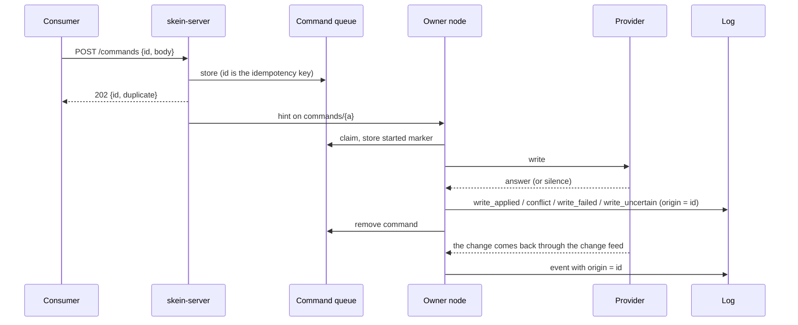

Consumers never write to a provider directly. They place a **command** next to the journal, and the account's owner runs it and journals the outcome.

## Command types

| Domain | Commands |
| --- | --- |
| Mail | `set_flags`, `set_labels`, `move`, `copy`, `delete` (optionally `to_trash`), `append` (optional `received_at`), `create_mailbox`, `rename_mailbox`, `delete_mailbox`, `refetch` |
| Sending | `send` (blob, envelope, optional `save_to_sent`, `send_at`, `dry_run`), `respond_invitation` |
| Calendars and contacts | `put_object`, `delete_object` (optional `notify`), `respond_object` |

Every command has a ULID `id`, which is the idempotency key: the same body under the same id is accepted as `duplicate: true`, another body under a used id is refused (`SubmitError::IdConflict`). Edits carry the version they were made against. Commands are queued with `skein_engine::submit_command` or `skein journal submit`, which check them first. The field-by-field shapes are in the [core README](https://github.com/peleda-app/rowboat/blob/main/skein/crates/core/docs/README.md).

## Outcomes

| Event | Meaning |
| --- | --- |
| `write_applied` | the provider carried it out |
| `conflict` | the object changed since the version the command was made against; nothing changed |
| `write_failed` | refused for good, with a machine-readable `reason`; nothing changed |
| `write_uncertain` | the request left and no usable answer came back: it may or may not have happened |

`write_uncertain` is deliberate. Skein never guesses and never repeats a write that cannot be repeated safely. Before a move, delete, append or send reaches the provider, a started marker is stored; if the node crashes after that, the command is reported uncertain instead of being run twice. Writes that are safe to repeat (`set_flags`, `set_labels`, `refetch`) and writes that provably never reached the provider (sign-in, configuration or throttling errors) run again later instead.

When the change comes back through the provider's change feed, its event carries `origin` = the command id.

## Versions and conflicts

Version preconditions per provider: ETag (CalDAV, CardDAV), `changeKey` (Graph), `etag` (Google), state (`ifInState`, JMAP). IMAP flags have no versions; Skein removes and adds flags separately, so concurrent flag edits commute.

Skein never merges. Resolving a conflict (rebase a patch, ask the user, give up) is the consumer's decision.

## Sending

`send` hands a prebuilt RFC 5322 message with an explicit envelope to the account's sending service. Skein is not an MTA.

- **Scheduled send:** a send is due at its `send_at`. There is no per-recipient send time; submit one `send` per time.
- **Undo window:** with `engine.send_undo_secs`, a send stays queued until `created_at` plus the window, so `DELETE .../commands/{id}` can still stop it.
- **Retries:** only while nothing can have been sent (service unavailable, temporary refusals, throttling), with backoff up to 8 tries, 1 minute doubling to at most 1 hour; a `Retry-After` from the service is honoured up to an hour. A send that may have left is `write_uncertain` and never resent.
- **Save to Sent:** when the service does not keep a copy itself (SMTP), the message is appended to the `save_to_sent` mailbox.
- **Dry run:** `dry_run: true` makes every check and resolves the sender, then records `write_applied` and `send_result` with `dry_run: true` without sending.
- **Result:** `send_result` lists refused recipients with code and permanence, where the sent copy is, the `Message-ID` recipients got when the sending service replaced it (`message_id`), and the service's own id for the message (`provider_message_id`) when it gave one.

## Cancelling

`skein_engine::cancel_command` (`skein journal cancel`) cancels a queued command. Cancelling and starting both write the command's marker with compare-and-swap, so whichever comes first wins: a cancelled command never runs, and a started one is refused with `SubmitError::AlreadyStarted`.
