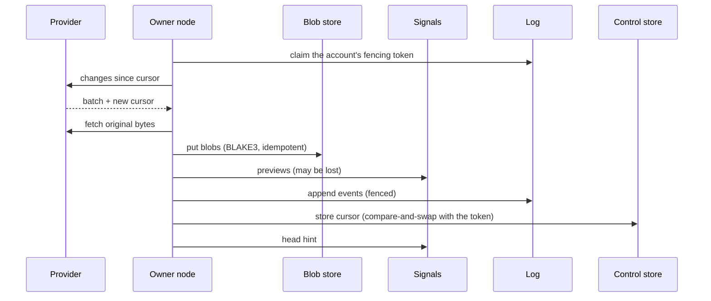
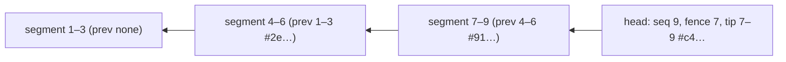

Every account has one journal: a sequence of events numbered from 1, without gaps. Only the account's owner writes it, so the order is strict.

## An event

```json
{
  "v": 1,
  "seq": 42,
  "at": 1732147201000,
  "account": "box",
  "key": "…",
  "origin": "01jd0000000000000000000001",
  "trace": "00-…-…-01",
  "body": { "type": "flags_changed", "…": "…" }
}
```

| Field | |
| --- | --- |
| `v` | schema version of the event |
| `seq` | position in the account's log, from 1, consecutive |
| `at` | milliseconds since the Unix epoch |
| `key` | the same for the same change seen twice; used to drop replays |
| `origin` | the command that caused this event, if any, so a consumer never mistakes its own write for someone else's |
| `trace` | the W3C `traceparent` carried from the command |
| `body` | the event itself, tagged by `type` |

Events are the journal's wire format, so their JSON form is a public contract. Unknown types from newer writers parse as `Unknown` in Rust; consumers in other languages should skip types they do not know.

## Event types

| Group | Types |
| --- | --- |
| Mail | `mailbox_upserted`, `mailbox_deleted`, `message_added` (with blob hash and size), `message_removed`, `flags_changed`, `labels_changed` |
| Calendars and contacts | `collection_upserted`, `collection_deleted`, `object_upserted` (blob with its version), `object_removed` |
| Account | `resync_required`, `first_sync_completed`, `account_health_changed` (`healthy`, `reauth_required`, `throttled`, `degraded`), `account_capabilities` |
| Command results | `write_applied`, `conflict`, `write_failed`, `write_uncertain`, `send_result` |
| Scheduling | `itip_received`, `schedule_result` |

The full list with every field is in the [core README](https://github.com/peleda-app/rowboat/blob/main/skein/crates/core/docs/README.md).

## How a sync writes

The engine writes every batch of provider changes in a fixed order, so a crash anywhere loses nothing and journals nothing twice:



- A blob is written before any event or preview that points at it.
- A crash between events and cursor makes the next run fetch the same changes again; the repeated events are dropped by their `key`.
- Every append and cursor write checks the fencing token, so a node that lost the account cannot write. See [ownership and fencing](/rowboat/concepts/ownership/).

## Segments and heads

Events are stored in zstd-compressed NDJSON segments under `tenants/{t}/log/{a}/`, with zero-padded keys so listing returns them in order. A segment counts only once the account's head covers it. Besides each account's head, a consumer can read every head of a tenant at once (`Log::heads`), so it polls one resource instead of one per account.

## Tamper evidence

The journal is a hash chain. The first line of every segment names its tenant, account, range and fencing token and the previous segment by its BLAKE3 hash; the account's head names the last segment (its *tip*) the same way.



- **From a trusted head, every segment can be checked**, wherever it came from: object storage, a cache, a replica. `skein_storage::Chain` walks back from the head and verifies each segment against the hash the next one holds; `locate` finds the verified segment holding any event; `verify_segment` checks bytes against a reference without reading anything.
- **Comparing heads detects rollback and withheld events.** A head behind a trusted one (lower `seq` or fencing token) is a rollback; one with the same `seq` and another tip is a fork. `verify_extends(trusted, newer)` also walks the segments in between and checks the newer chain passes through the trusted tip.
- **Heads can be attested.** A `HeadAttestor` (none by default) signs every head the journal writes and checks every head it reads, so a head read from untrusted storage can be trusted. The head includes the fencing token, so an attestation can be bound to the node holding the account's lease.
- **The journal checks itself as it reads.** Each read checks that consecutive segments link and that the last one matches the head, and the journal refuses a head older than one it has already seen, so a rolled-back head never makes it write over committed events.

The cost is one BLAKE3 pass over each segment's compressed bytes on write and read, about 200 bytes more per head, and no extra storage requests; a chain walk costs one read per segment walked. Journals written before chaining keep reading; their chain starts at the first segment written after the upgrade.
