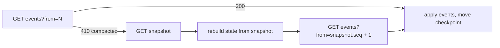

A snapshot is the state of an account at a log position: every mailbox with its messages (item, blob, size, flags, labels, received time), and every calendar and address book with its objects (blob and version). A new consumer loads the latest snapshot and reads the log after it, instead of replaying everything from event 1.

## When snapshots are taken

- After a successful sync, once at least `snapshot_every_events` events (default 5,000) were appended since the last snapshot.
- Any node may take one, since a snapshot is derived from the committed log.
- The last two snapshots are kept.

`Log::latest_snapshot` returns the latest one, or nothing before the first.

## Compaction

Events covered by a snapshot older than the retention window (`retain_days`, default 7) are removed. A consumer that falls behind by less than the retention window never needs the snapshot.

A reader that starts before the first remaining event gets `410 compacted` from `GET .../events` (and a compaction notice from webhooks). It then loads the snapshot and reads on from the snapshot's `seq`:

## Retention defaults

| What | Default |
| --- | --- |
| Blobs | not expired by the engine; use a lifecycle rule (for example 30 days) |
| Log segments | removed when covered by a snapshot older than the retention window |
| Snapshots | the last two are kept |
| Commands | removed from the queue once their outcome is in the journal |
| Control records | small, do not grow |
