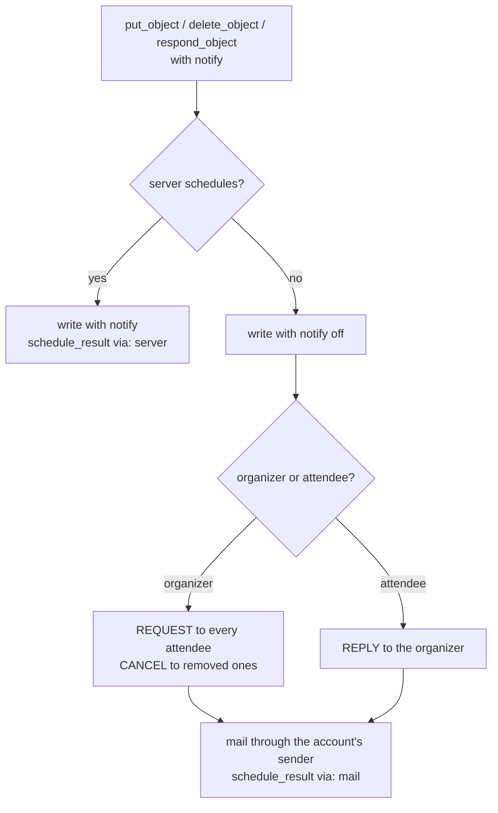

Skein carries scheduling messages; it does not decide policy. It tells the other side of a calendar change when asked to, journals invitations that arrive by mail, and leaves trusting and applying them to the consumer.

## Who tells the other side

`put_object`, `delete_object` (with `notify`) and `respond_object` (`notify` on by default) ask the provider whether the server schedules itself:

| Provider | Scheduling |
| --- | --- |
| Google Calendar | server (`sendUpdates`) |
| Microsoft Graph | server |
| JMAP Calendars | server (`sendSchedulingMessages`) |
| CalDAV with `calendar-auto-schedule` | server |
| CalDAV without it | client: Skein mails the messages |

Where the server does not schedule, the engine reads the object before an organizer's change, writes with `notify` off, and sends what RFC 6638 asks of a scheduling agent through the account's sender, built with `skein-itip`: `From` the organizer's or attendee's address, `DTSTAMP` from the command's time. Attendees marked `SCHEDULE-AGENT=CLIENT` or `NONE` are left out.

`schedule_result` says who told whom: `via` is `server`, `mail` (each message with `sent`, `failed` or `uncertain` and refused recipients) or `none` with a reason (`not_organizer`, `not_a_scheduling_object`, `no_attendees`, `previous_unknown`, `attendee_not_found`, `organizer_not_scheduled`, `no_sender`). Scheduling messages are never retried; a crash while they go out is reported as `interrupted`, so a message is never sent twice for one change.

## Answering

- `respond_object` sets one attendee's `PARTSTAT` (`accepted`, `declined`, `tentative`) on an event in a calendar, with an optional comment, through the provider's own way of answering. On CalDAV it rewrites the object with `If-Match`; with `notify` off on a scheduling server the write carries `Schedule-Reply: F`.
- `respond_invitation` answers an invitation that came by mail (the invitation's blob) with an iMIP `REPLY`, under the rules of `send`: retries while certainly not sent, `write_uncertain` once it may have left, `send_result`, optional `save_to_sent`. `From` the attendee, `To` the organizer, `In-Reply-To` and `References` from the invitation.

## Incoming

A synced message with a `text/calendar` part that has a `METHOD` is followed by `itip_received`: the mailbox, the item, the decoded calendar part as a blob, and its facts (method, component, `UID`, `SEQUENCE`, `RECURRENCE-ID`, organizer, attendees with `PARTSTAT`). Nothing is applied. Deciding whether to trust a reply and applying it to the organizer's copy is consumer policy; applying is an ordinary `put_object`.

A CalDAV scheduling inbox can be listed as a collection with `role: schedule_inbox` (the `schedule_inbox` setting); its objects are the iTIP messages the server delivered and can be removed with `delete_object`.

## Building other messages

`COUNTER`, `REFRESH` and other methods are not sent by the engine. Consumers can build them with the `skein-itip` crate and send them with a `send` command. See the [skein-itip README](https://github.com/peleda-app/rowboat/blob/main/skein/crates/itip/docs/README.md).

## Not done yet

Free-busy through the scheduling outbox, and live tests of answering on Google and Graph.
