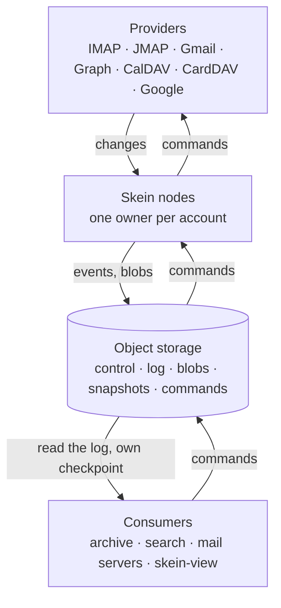

Skein connects to mail, calendar and contacts providers and keeps nothing but a journal. It turns every change on IMAP, JMAP, the Gmail API, Microsoft Graph, CalDAV, CardDAV, Google Calendar and Google People into an append-only log in object storage, and carries out write commands that consumers put next to that log. Consumers build their own databases from the log: archives, search, thread views, mail servers. Skein itself stays dumb and, as far as possible, stateless.

Skein is written in Rust and is part of rowboat, source-available under the PolyForm Noncommercial License 1.0.0. It is in early development: the contracts can still change.

## Principles

- **The journal is the truth.** Every change Skein sees becomes an event in a per-account log; every piece of content is stored once as a blob addressed by its BLAKE3 hash. Any database a consumer builds can be rebuilt from the log and the blobs.
- **Dumb core.** Skein does not parse content for features, index, thread, merge edits or decide policy.
- **Stateless instances.** No local disk and no database are required on a server. The little durable state Skein needs lives in object storage with compare-and-swap.
- **Distribution by contract.** Who owns an account, how nodes see each other and where the journal lives are contracts with replaceable implementations.
- **Losing memory is harmless.** Data kept only in memory (liveness, hints, previews, caches, access tokens) may vanish at any moment; every reader has a durable fallback.
- **Consumers own their projections.** Each consumer reads the log at its own pace with its own checkpoint.
- **Original representation is kept.** The provider's original bytes are always stored, so unknown properties survive a read–edit–write round trip.

## Domains

Mail, calendars and contacts share one account, one OAuth connection and one engine.

| Domain | Providers |
| --- | --- |
| Mail | IMAP, JMAP, Gmail API, Microsoft Graph |
| Calendars | CalDAV, JMAP Calendars, Google Calendar, Microsoft Graph |
| Contacts | CardDAV, JMAP Contacts, Google People, Microsoft Graph |
| Sending | SMTP submission, JMAP `EmailSubmission`, Gmail send, Graph `sendMail` |

## Architecture

## Out of scope

Bulk and marketing sending and decisions about content (parsing, indexing, threading, merging edits, spam verdicts) stay out of the core. Most of them can be built on top of Skein: see [out of scope, and how to build it](/rowboat/start/out-of-scope/).

Next: [ways to use it](/rowboat/start/ways-to-use/) and the [quick start](/rowboat/start/quickstart/).
